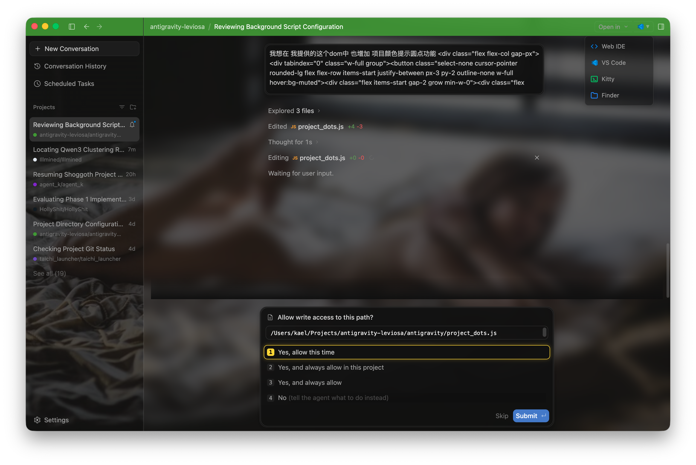
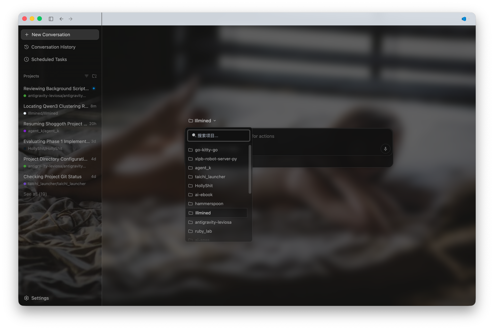

# Antigravity Leviosa

<p align="center">
  
  
</p>

## What's in the Box? 

- 🌠 **Soul-Infused Wallpaper**: How can you even write code with a soul without a custom background image?<br>
  🌠 **注入背景图**：没有背景图，怎么能写出有灵魂的代码！

- 🎨 **Peacock Topbar**: Reuses your VS Code Peacock extension configs, saving you from the absolute tragedy of running a command in the wrong project.<br>
  🎨 **孔雀顶栏**：复用 Peacock 插件的配置，避免了把某个项目的指令发送到另一个项目的悲剧。

- 🟢 **Peacock Indicator Dots**: The native project grouping is ugly and un-sortable. Lighting up these colored indicators is the only way to survive.<br>
  🟢 **孔雀提示灯**：按项目分组太丑还不能排序，只有开提示灯才能维持生活啊。

- 📋 **Slide-Down Task Kanban**: A sleek frosted-glass Kanban board right under the topbar, crafted for those who are on the verge of madness from concurrent multitasking.<br>
  📋 **下拉式任务看板**：顶栏一键滑出高透毛玻璃看板，专为并行开发走火入魔的人士设计。

- 🔍 **Project Search Filter**: Because Google engineers probably only have one project... or they're secretly using Claude Code.<br>
  🔍 **项目列表搜索**：Google 的工程师可能只有一个项目，或者他们其实用的是 Claude Code...

- ⚡ **Conversation History Page**: Google thought search could replace the history page... so we replicated it before they axe it, while sneaking in a bunch of awesome extras. Definitely won't be worse than native~<br>
  ⚡ **会话历史页面**：官方觉得搜索功能可能替代历史页面……在下架之前复刻了一个，顺便植入了一些乱七八糟的功能，反正不会比原生的难用~

- 🖱️ **Permission UX Overhaul**:Double-click to submit, plus highlighted borders. Isn't this basic UX? This Electron app's interaction design is literally worse than a CLI...<br>
  🖱️ **权限操作优化**：支持双击提交，增加高亮边框（这不基操么，Electron 交互做得连 CLI 都不如的玩意儿...

- 🚀 **One-Click IDE Opener**: Replaces the native IDE button with a slick multi-app dropdown menu. Open any project directly in VS Code, Kitty terminal, or Finder with a single click!<br>
  🚀 **一键闪现 IDE**：无缝接管原生的打开按钮，注入多应用下拉菜单。一键直达 VS Code、Kitty 终端或者 Finder，告别繁琐的路径跳转！

- 🧠 **Command & Knowledge Injector**: Type `#cmd` to instantly inject markdown commands and knowledge fragments directly into your prompt!<br>
  🧠 **知识库注入器**：输入 `#cmd` 即可瞬间将 markdown 知识片段注入到你的提示词中！

- 🔄 **Fast Session Switcher**: Use `Ctrl + Tab` to smoothly cycle between active project sessions like a real browser.<br>
  🔄 **快速会话切换**：使用 `Ctrl + Tab` 像真正的浏览器一样在不同项目间丝滑切换。

- 📦 **Deep & Shallow Archive Tool**: Intelligently cleans up and compresses old agent logs (both shallow and deep) for absolute OCD relief.<br>
  📦 **深/浅度归档工具**：智能清理并压缩旧的 Agent 日志，提供深浅双模式，绝对的强迫症福音。

- ✏️ **In-Place File Editor**: Google lets you view files in the right panel, but editing them? "Please install an IDE." Double-click any file preview to edit in-place with crystal-clear syntax highlighting and `⌘S` auto-save. Isn't this supposed to be an AI workspace?<br>
  ✏️ **原地双击编辑**：右侧抽屉只许看不许改是几个意思？改个错字还得专门唤醒外部 IDE。双击直接原地进入高亮编辑，`⌘S` 秒级存盘刷新，这才是正经工作台嘛！

- 🛡️ **Project-Level Permissions**: Brought back axed project permissions along with a bunch of interaction-layer polish. Look, I know what Google's PM was thinking: project permissions are useful, but 4 buttons (especially with three of them repeating the entire mile-long command) were hideous. That diagnosis was right—but that final decision... did Gemini make it for you?<br>
  🛡️ **项目级权限**：找回了被砍的项目权限，顺手还做了一些交互层的优化。其实我懂 Google 产品经理是怎么想的：项目权限是有用的，但 4 个按钮（特别是三个按钮里都带着长长的命令本身）太丑了——这个判断是对的，但最后的决策，是 Gemini 帮你做的么？

- 🐱 **KitiGravity**: God might have given us a hundred ways to open a terminal, but who could possibly resist summoning a kitty with a single click?<br>
  🐱 **KitiGravity**：虽然上帝给了100种打开终端的方式，但是谁能拒绝一键召唤小猫呢？

## Background

Google decided to bless us with a whole bunch of updates on May 20th:
- More colour Gemini web and app with STRANGE (aka Ugly) Chinese typography (I'm sure AI wrote the i18n code...)
- Antigravity became an AI-first dashboard, and the original IDE mode got renamed to *Antigravity IDE*. All the original data got hooked up to the new Antigravity (where a single conversation is treated as a project). Meanwhile, the data in the IDE went... completely wiped out. (Seriously, does any PM actually have the authority to make a decision like this?)


So Antigravity? Well... Gemini is smart, but *only* inside Antigravity. After all, it's tens of light years away — you literally *need* Antigravity to not look like an idiot.


Be fair, the dashboard is cool, especially for someone with as many concurrent projects as me (or those who are forced to split themselves into multiple clones...). And it should be Antigravity's destined role (we already have too many VS Code clones out there...).

 However, switching projects on the old panel was painfully slow. But now, it is as smooth as butter so be glad to unload Antigravity IDE now! (since it become pure white and with almost twice size of the dashboard..)


Sure, the dashboard still has a few clunky spots, and RIP to our VS Code extensions. But hey, thanks to Electron, we can just hit it with a good ol' *Leviosa*!

## Quick Start 快速开始

At its core, this extension works by injecting custom JavaScript and CSS directly into the dashboard to override the default UI and introduce new behaviors. While many features run entirely in the browser, some dynamic functionalities rely on querying a local data source.

**核心原理**：本质上，这个扩展是通过直接向面板注入自定义的 JavaScript 和 CSS 来覆盖默认 UI 并引入新功能的。虽然很多功能完全在浏览器内运行，但部分动态功能需要依赖于查询本地数据源。

> 🇨🇳 [点击这里中文版指南 (Quick Start)](./QUICKSTART_zh.md) | [中文说明文档 (Full README)](./README_zh.md)

To get everything up and running, follow these three steps:

### Step 1: Download the Scripts
To integrate seamlessly with Taichi, clone this repository directly into Taichi's apps directory as a plugin entity:
1. Ensure you have the Taichi service installed and running.
2. Open your terminal and run the following command:
   ```bash
   git clone https://github.com/catclever/antigravity-leviosa.git ~/Library/Services/taichi/apps/com.google.antigravity
   ```
3. You're good to go! Once Taichi is running locally, it automatically discovers the plugin.

### Step 2: Setup the Local Data Source
To unlock the full potential of this extension, you'll need a local API endpoint running in the background. You have two ways to set this up:

#### Method 1: The "Taichi" Way (Recommended, Mac Only)
This extension is designed to work seamlessly with my local **Taichi** service (currently Mac Only), which acts as the primary data source and automatic script injector for these dynamic configurations.

1. Clone and start the Taichi service: [https://github.com/catclever/taichi](https://github.com/catclever/taichi)
2. Since you've already cloned this repository directly into Taichi's `apps` directory in Step 1, no further file copying is needed.
3. Once Taichi is running locally, it automatically hosts these files and exposes the required endpoint at `http://127.0.0.1:9216`.
4. **Automatic Cyber Injection (Skip Step 3!):** Taichi comes with the **`tai`** interactive CLI launcher. Instead of manually running snippets, launch Antigravity with cyber injection mode via your terminal:
   ```bash
   tai cyber antigravity
   ```
   *(Or simply run `tai` and select `⚡️ Cyber` -> `Antigravity` via the interactive fuzzy finder).*
   Taichi automatically attaches and injects `web/main.js` into the dashboard runtime—**meaning you can completely skip Step 3!**

#### Method 2: The DIY Mock Server
If you don't want to pull the entire Taichi repo, no worries! You can easily spin up a tiny local mock server using Node.js to satisfy the API requirements. 

We have prepared a quick-start guide. Click the link below for the full scripts:
- [Using Node.js (Quick & Easy)](./mock_server_node.md)

Whichever method you choose, ensure the service is running before proceeding to the final step (if using DIY Mock Server).

### Step 3: Configure Antigravity (DIY Mock Server Only)
> 💡 **Notice:** If you use **Taichi (Method 1)** with `tai cyber antigravity`, Taichi automatically handles the injection lifecycle for you—**you can completely skip this step!** This step is only required if you are using the DIY mock server or manual snippet execution.

Finally, you need to tell the Antigravity dashboard to load these custom scripts:

1. ~In the Antigravity dashboard, open the Developer Tools by pressing `Command + Option + I` (on Mac).~ *(Note: Following the June 12, 2026 Google update, this shortcut is now disabled. You will need to access it via web-based debugging mode instead. Please search for instructions on how to enable this. Though if you use Taichi, you won't need to worry about this at all~)*
2. Navigate to the **Sources** tab.
3. In the left panel (you might need to click the `>>` icon), select **Snippets** and create a new snippet.
4. Enter the following code into the snippet editor:
   ```javascript
   import('http://127.0.0.1:9216/src/apps/com.google.antigravity/web/main.js')
   ```
   *(Note: The port and endpoint here should match your configuration. If you used the DIY mock server in Step 2 instead of Taichi, you'll need to ensure your local server also serves the directory containing `main.js` statically at this path).*
5. Right-click the snippet name and select **Run** (or press `Command + Enter`) to execute the code.

## Important Notes 注意事项

- **Re-injection Required (DIY Mode):** When manually injecting via Developer Tools, the snippet does not persist across app restarts. Every time you fully quit and reopen Antigravity, you need to re-run the snippet (Step 3). With **Taichi**, simply launch via `tai cyber antigravity` and injection is handled automatically in the background.<br>
  **每次重启需重新注入（DIY模式）**：通过开发者工具手动注入的功能不会在应用重启后驻留。每次完全退出并重新打开 Antigravity 后，都需要重新运行一次 Snippet（即重复第三步）。如果使用 **Taichi**，直接使用 `tai cyber antigravity` 唤醒即可自动在后台完成注入，无需手动干预。
- **Google "Moves Fast and Breaks Things":** Antigravity is an actively updated product. Future updates to their dashboard's DOM structure or React components might cause some of these features to temporarily or permanently break. (Honestly, I hope Google just natively integrates these features soon so we don't have to keep injecting scripts...)<br>
  **速生速死**：Antigravity 是一个在积极更新的产品。如果未来 DOM 结构或者 React 组件发生重大变动，可能会导致某些功能暂时或者永久失效。（早用早享受哦~）

## Features & Configuration

Every feature in this mod is cleanly separated into its own module. Here is a breakdown of what each script does and how you can tweak it:

### 1. `main.js` (The Entry Point)
This is the conductor that imports and initializes all other modules.
- **Customization:** If you don't like a specific feature (e.g., the background image), you can easily disable it by simply commenting out its `initX()` function call. This is also the place to import and initialize any of your own custom feature scripts!

### 2. `api.js` (The Data Bridge)
Handles all communication between the dashboard and your local data source (Taichi or Mock Server). Rather than just fetching colors, it acts as a universal bridge calling various modular scripts located in the `worker/` directory (e.g., triggering IDE openings, fetching knowledge indexes, and retrieving theme colors).
- **Caching:** For expensive operations like theme lookups, it features a built-in L2 memory cache with a Time-To-Live (TTL) of **1 hour** to keep the UI snappy.
- **Robust Path Resolution:** When worker scripts (like theme syncing) need to find your actual local project folders, they rely on a powerful `project_resolver.js` utility in the backend:
  1. **Multi-Root Workspace Parsing:** It splits comma-separated project names and scans each sub-project sequentially.
  2. **SQLite Exact Matching:** It directly queries the IDE's local SQLite database (`state.vscdb`) to fetch the absolute paths of your recently opened workspaces. This ensures `O(1)` precision without requiring any manual path configuration!
  3. **Fuzzy Fallback:** If the exact path isn't found in the database, it falls back to a fuzzy search across common fallback directories.

### 3. `background.js` & `random_bg_image.js` (Workspace Background & Random Wallpaper)
Injects a beautiful random background image from your local machine into the dashboard, along with base CSS tweaks to make the UI gorgeous.
- **Local Random Wallpaper:** It automatically picks a random image from your `~/Pictures/wallpaper` folder and refreshes it on every load! Rather than returning bulky Base64 strings, the backend worker copies the chosen image to `web/bg_cache.<ext>` for direct static serving (with automatic cache cleanup), completely bypassing file size limits.
- **Customization:** You can add more local directories or change the fallback image by modifying the `CONFIG` object at the top of `background.js`. Feel free to dive into the CSS within this file to explore and tweak properties like the background blur (`backdrop-filter: blur(...)`), overlay opacity, and layout spacing to match your exact aesthetic preferences!

### 4. `topbar_color.js` & `antigravity_theme_sync.js` (Dynamic Topbar)
Dynamically changes the topbar's background color based on the project you are currently viewing. It supports cascading multi-directory workspace configurations (`peacock.color` / `titleBar.activeBackground` in `.vscode/settings.json`) and automatically calculates the color luminance to ensure the text and icons remain readable with softened light/dark contrast.

### 5. `project_dots.js` (Project Indicators)
Adds a slick, colored indicator dot next to the project names in the sidebar or subtitles, giving you a quick visual cue of your current project context.
- **Compatibility:** Fully supports both the classic Antigravity dashboard sidebar and the newly updated flexible DOM structures.

### 6. `project_search.js` (Project Filter)
Injects a highly responsive search box directly into the project selection popover dialog. Since the new dashboard groups conversations into a massive list, this makes filtering and finding your specific project a breeze!

### 7. `double_click_submit.js` (Fast Submit & UI Polish)
Adds a slick golden border and glow to the currently selected radio button options in dialogs, making it much clearer what you have selected. More importantly, it introduces a "click-again to submit" behavior: if you click an already-selected radio option, it will automatically find and trigger the "Submit" button for you. This dramatically speeds up interactions when dealing with multiple-choice workflows!

### 8. `project_opener.js` & `antigravity_open_project.js` (One-Click IDE Opener)
Overrides the native "Open Editor" or "Install IDE" button by injecting a customizable dropdown menu, allowing you to open the active project directly into your preferred tools (VS Code, Kitty, Finder, etc.). It supports both single directories and multi-root workspaces (remembering your preferred sub-folder in `ag_kitty_dir_pref_v1`), hides the Antigravity web IDE option if uninstalled, and links `Open in -> Kitty` directly with the KitiGravity companion pool (hold `⌥ Option` while clicking to toggle/hide the companion window).
- **Customization:** You can modify the `CONFIG.apps` array at the top of `project_opener.js` to add custom IDEs, change the default application, or update the SVG icons.
- **Backend Requirement:** This feature relies on the local service (Taichi or Mock Server) to execute the actual shell commands. It expects the endpoint `/api/script/apps/com.google.antigravity/worker/antigravity_open_project` to be available. If using a DIY mock server, you must implement this endpoint to handle the `open` commands.

### 9. `agy_archive.js`, `archive_brain.js` & `archive_hook.js` (Deep & Shallow Archive + 30-Day Auto-Lifecycle)
An intelligent archiving and lifecycle engine that provides absolute OCD relief by cleaning up verbose `.system_generated` logs and `scratch` directories within individual `brain` folders, resolving UUIDs and projects via `conversation_summaries.db`, bundling `.tar.gz` archives, and maintaining `archive_index.json`.
- **Cascading Deep-Archive Purge:** Before deep-archiving a session, recursively discovers and purges all spawned subagent `.pb` trajectories, SQLite rows, and `brain` folders plus associated `/tmp` task logs, keeping local storage pristine.
- **Two-Stage 30-Day Auto-Lifecycle & Cloud Offload:** Runs a debounced daily check (`archive_hook.js`) that auto-shallow-archives idle conversations (>30 days, exempting sessions bound to active/in-review Kanban tasks) and auto-deep-archives long-dormant shallow archives (>30 days). Supports optional `rclone` cloud cold-backup (`offload` / `restore`) with strict byte-size and SHA-256 verification before evicting local tarballs.

### 10. `kb_trigger.js` & `antigravity_knowledge_index.js` (Command & Knowledge Injector)
A powerful feature that lets you instantly inject reusable instructions and knowledge fragments into your chat prompt. Simply type `#cmd` (for all), `#cmdg` (for global), or `#cmdl` (for local) in the message input box to trigger a frosted-glass dropdown menu with color-coded badges (`Global`, `Instruction`, and `Knowledge`). Select an item, and it's smoothly injected into your prompt with input-locking protection and batch selection replacement to prevent Lexical editor lag!
- **Global Scope:** Reads from `~/.gemini/kb/*.md`
- **Local Scope:** Reads commands from `~/.gemini/Projects/<project>/commands/*.md` and knowledge from `~/.gemini/Projects/<project>/kb/*.md`

### 11. `session_switcher.js` (Fast Session Switcher)
Brings the standard browser tab-switching experience to the Antigravity sidebar! Use `Ctrl + Tab` to cycle to the next active project session, and `Ctrl + Shift + Tab` to cycle to the previous one. It intelligently calculates the DOM position to ensure smooth scrolling.

### 12. `open_path_in_finder.js` & `antigravity_open_file_in_finder.js` (Open Path in Finder)
Adds a native-feeling right-click context menu (`📂 在 Finder 中打开`) to file paths and filenames across the chat stream and sidebar. Even when the UI truncates the directory path and only renders a bare filename, it reverse-engineers the underlying **React Fiber tree (`__reactFiber$`)** to extract the exact absolute path and reveal it directly in macOS Finder.

### 13. `panel_inject.js` & `pm_dashboard_api.js` (Project Task Kanban Dashboard)
Injects a sleek toggle button next to the sidebar search icon that slides down a viewport-anchored, frosted-glass **3-column Kanban board (`Backlog` / `Active` / `Completed`)** right below the topbar.
- **Workflow Companion:** Designed to work hand-in-hand with our task management system and agent disciple framework: [catclever/agy-disciple](https://github.com/catclever/agy-disciple).
- **Markdown-Driven:** Directly parses task cards (`.md` files with YAML frontmatter) from `~/.gemini/Projects/<project>/tasks/`, rendering priority-colored left borders (`high`, `medium`, `low`) and tag badges.
- **Interactive Workflows & Session Spotlight:**
  - **Current Session Spotlight & One-Click Jump:** Automatically pins cards bound to the currently open conversation to the top of their column with a glowing border and `📍 当前对话` badge; other cards provide `💬 跳转对话` / `📦 跳转归档` buttons for instant zero-reload SPA jumps (or `☁️ 已冷备` for cold-archived sessions).
  - **Start in New Chat:** Click `在新对话中启动` on any `Backlog` card to smoothly close the panel, spin up a new chat session, and auto-fill a structured execution prompt linked to `kanban-task-manager`.
  - **Qled Integration:** Click any card to open its underlying Markdown file directly via the `qled://open?path=...` protocol.
  - **Quick Actions & Ref-Counted Safe GC:** Mark `in_review` tasks as completed with a single click—cleaning `/tmp` task logs and safely garbage-collecting subagents only when no other active tasks share the session—or abandon/delete unstarted `Backlog` tasks with confirmation.

### 14. `history_view.js` & `conversation_history_api.js` (Conversation History ⚡ Central View)
Replaces the native History button with an enhanced `Conversation History ⚡` central dashboard powered directly by Antigravity's local `conversation_summaries.db` SQLite database.
- **Project Grouping & Theme Linkage:** View sessions in a chronological **Timeline** or grouped by **Project cards** with dynamic Peacock theme-colored borders, folder icons, and indicator dots. Archived conversations are neatly tucked into a collapsible drawer at the bottom of each project card.
- **Cold-Archive Fusion & One-Click Restore:** Merges deep-archived and cloud-offloaded sessions from `archive_index.json` directly into the history view with `☁️ 115` / `Cloud` cold-storage pills, one-click pull-and-restore buttons, and a manual 30-day lifecycle inspection button in the header.
- **Subagent Isolation & One-Click Cleanup:** Automatically filters out background subagent and CLI trajectories from the main view while displaying a live `Subagents` counter badge in the header—complete with a one-click cleanup action to purge subagent `.pb` files, DB rows, and `brain` folders.
- **Smart De-noising & SPA Routing:** Filters out empty `Untitled` draft sessions, auto-derives semantic titles from the first prompt or `/goal` command, and switches conversations instantaneously without page reloads via TanStack Router (`window.__TSR_ROUTER__.navigate`).

### 15. `account_login_inject.js` & `account_manager.js` (Multi-Account Switcher & Quota Monitor)
Provides seamless multi-account profile management, live quota visibility, and hot-switching without repetitive OAuth browser logins.
- **Dual UI Entry Points & Live Quota Monitor:** Injects `Select Saved Account` and `Login via Refresh Token` buttons onto the welcome/login screen, plus compact **Switch Account** and **Add Account `+`** icon buttons next to `Sign Out` in `Settings -> Account`. Account cards display cached **Gemini** and **Claude** remaining quota percentages instantly while refreshing asynchronously in the background (with a header refresh button).
- **Profile Archiving & Hot-Swap:** Archives account credentials and metadata in `~/.gemini/.accounts/`. Switching accounts automatically updates `state.vscdb`, macOS Keychain entries, and standalone OAuth tokens on the fly, with built-in support for importing or refreshing accounts via Refresh Tokens (RT).
- **External Configuration:** OAuth client credentials are kept strictly out of git. Simply run `python3 scripts/extract_oauth_clients.py` to auto-extract them, or create `oauth_clients.json` following `oauth_clients.example.json`.

### 16. `file_editor.js` & `antigravity_file_api.js` (In-Place File Editor)
Turns Antigravity's read-only file preview drawer into a fully functional in-place code editor with zero external IDE dependencies.
- **Trigger & Hotkeys:** Double-click anywhere in the file preview content to enter edit mode. Press `⌘S` (macOS) / `Ctrl + S` to save directly to disk via atomic Worker API calls and refresh the native view; press `Esc` to exit without changes.
- **Ultra-Clear Highlighting & Alignment:** Uses an inverted z-index dual-layer architecture with a top-most `<pre>` layer (`pointer-events: none`) over an input `<textarea>`, eliminating subpixel font antialiasing haze. Out of the box support for JS/TS, Python, JSON, Markdown, HTML, CSS, Shell, and YAML.
- **IDE Gutter & Single-Line Scroll:** Gutter line numbers strictly adhere to `white-space: pre` to prevent number-wrapping collapses. Code defaults to single-line horizontal scroll (`nowrap`) ensuring exact 1-to-1 line number alignment, with a toggleable wrap switch in the status bar.
- **De-cluttered Chrome:** Pure SVG icon action buttons (Save 💾, Exit ✕, Format ✨) with hover tooltips, plus a dedicated bottom status bar displaying `Line/Col`, character count, total lines, encoding, and language mode.

### 17. `project_permissions.js` & `project_permissions_api.js` (Project-Level Permissions & Auto-Approval Daemon)
Restores granular per-project permission control (removed from the official dashboard) via a dual-engine architecture—unlocking independent conversation-level presets in the chat footer while running a background ConnectRPC daemon that evaluates and auto-approves `waitingSteps` across concurrent project sessions and subagents without polluting global `config.json`.
- **Entry Points & How to Enable:** Click the shield icon (`🛡️`) immediately left of the project name in the topbar to open the **Quick Permission Popover**, or go to `Project Settings` (right above `Skills`) for the full **Project Permissions** card (including `File Access`, `Internet Access`, `Auto-Execution`, and `Sandbox` policies). Flip the header toggle (`已启用` / `未启用`) anytime to enable or pause project-level rules.
- **In-Prompt Morphing Shield (`Always in this project`):** Streamlines verbose native confirmation labels via pure CSS (`Yes, allow this time` / `Yes, always allow in this conversation` / `Yes, always allow`). When project permissions are enabled, a muted shield button appears beside the `in this conversation` option—click it to collapse the left option into a compact key badge and expand the golden `🛡️ Always in this project` capsule, then click **Submit** (or press `Enter`) to approve and save the rule to the current project.
- **Action Pills, Wildcards & In-Place Editing:** Rules render as uniform `72×20` color-coded pills (`✓ read`, `× write`, `url`, `command`, `mcp` — green `✓` for Allow, red `×` for Deny) paired with clean bare paths/patterns. Click any pill to flip Allow/Deny on the spot; click any path to edit in-place (the action pill shrinks to a locked single-letter badge for maximum path width). Supports prefix matching plus `*` wildcards across multi-line commands (e.g., `python3 *`) and automatic subpath coverage on wildcard domains/directories (e.g., `*.github.com`, `/Projects/*/src`).
- **Smart Common-Ancestor Merge (`🪄`):** When multiple rules share a parent path, click the magic wand icon (`🪄`) in the rule header to scan via a bottom-up Trie and propose merges stopping strictly at the **first (deepest) common ancestor** (never over-merging into `$HOME` or `/`). Confirm merges inline, or click the muted block icon (`🚫`) to pin unwanted directories to a per-project ceiling-barrier list (`rejectedMergeDirs`), which can be inspected or restored anytime from the header icon.
- **Topbar Hit Toast & Atomic Storage:** Auto-approved background or foreground actions trigger a minimalist 3-element toast (`🛡️ Project` + action pill + target) anchored directly beneath the topbar shield icon. All rules and policies are atomically persisted to `~/.gemini/config/projects/<id>.json` and `~/.gemini/antigravity/project_permissions.json`.

### 18. `kitty_companion.js` & `antigravity_kitty_api.js` (KitiGravity Companion Terminal)
Pairs each project with an on-demand **Kitty 0.49+** companion terminal (`kitten @` remote control via `/tmp/mykitty-*`), giving you one-click command staging and execution without touching your everyday main Kitty windows.
- **Kitty Dependency (Auto-Hidden When Uninstalled):** Strictly depends on a local [Kitty](https://sw.kovidgoyal.net/kitty/) installation (`kitty` / `kitten`). If Kitty is not installed on your machine, KitiGravity gracefully disables itself—companion entry points, selection floating buttons, and codeblock quick-send icons stay completely hidden with zero UI clutter.
- **Isolated Companion Pool & Exclusive Show/Hide:** Companion OS Windows are tagged with `agy_companion=1` and per-project metadata. Summoning or sending commands to the current project's companion automatically hides other projects' companion windows and focuses the active one—leaving your normal Kitty windows 100% untouched (hold `⌥ Option` when clicking `Open in -> Kitty` in the topbar to fold/hide).
- **Selection Floating Bar & Codeblock Header Button:** Highlight any text inside the conversation view to bring up a floating `🐱 Kitty` button right beside `Quote` / `Edit`, or click the cat-ears terminal icon injected in the header of AI shell/CLI codeblocks (`bash`, `zsh`, `sh`, etc.).
- **Safe Stage vs. Instant Run & Busy-Shell Protection:** Left-click **stages** the command safely into Kitty via bracketed paste (stripping leading `$`/`%` prompts, supporting chunked UTF-8 transfer for long scripts) without pressing `Enter`; hold `⌥ Option` + click to **execute immediately**. Automatically realigns drifted working directories back to the project root, spawns a new tab inside the companion window if the active shell is busy (`at_prompt === false` or in alternate screen like `vim`/`htop`), and remembers your chosen sub-directory in multi-root workspaces (`ag_kitty_dir_pref_v1`).

> **Note**: The `sidebar_reorder.js` feature (which previously folded pinned conversations) has been retired and removed from the default load, as the Antigravity dashboard has officially added native support for this! 🎉

## Todos
- 💻 **VSGGravity**: Even if it absolutely has to be opened in an IDE, Google probably pick Antigravtity IDE...But why not VSCode?<br>💻 **VSGGravity**：就算一定要在IDE中打开，Google应该也不会选它吧？但是为什么不选它呢？
- ⚡ **ZediGravity**: Did you say IDE? Step aside, you sins of Electron!<br>⚡ **ZediGravity**：你说IDE？就让我来涤荡Eletron的罪孽吧！
- ……

**幸甚至哉，鸽以咏志！**

（如果你看得懂，请不要尝试翻译，把它留给ai吧...）