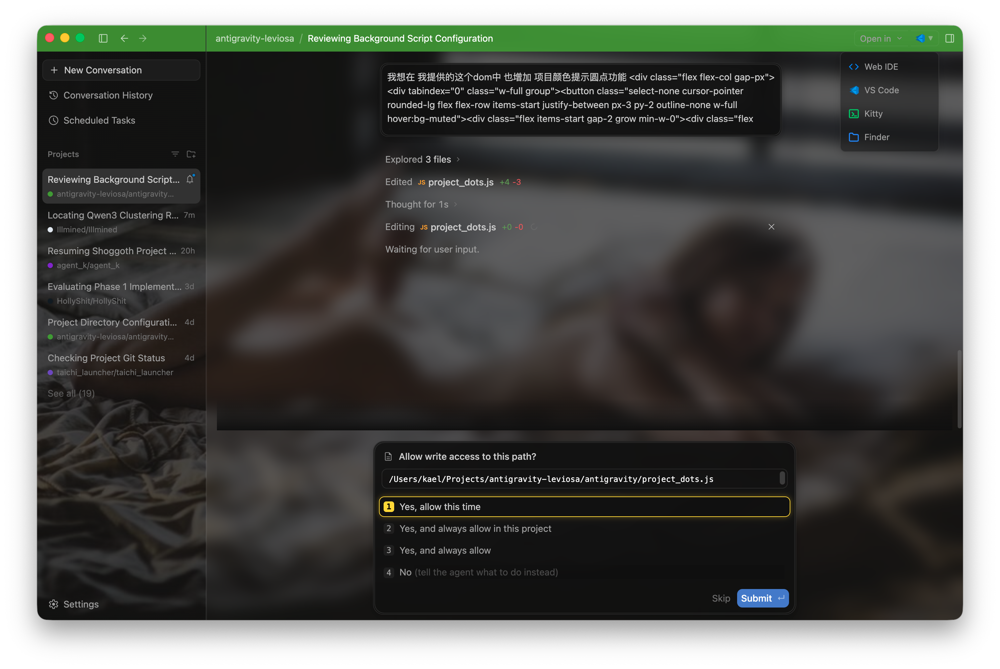
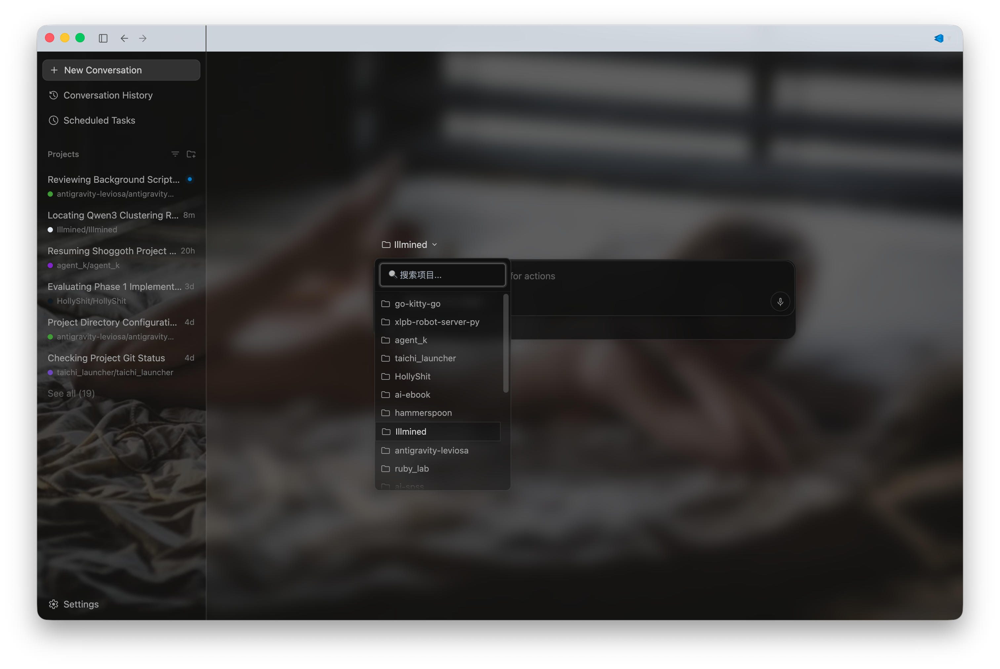

# Antigravity Leviosa

<p align="center">
  
  
</p>

## 盒子里面有什么？ (What's in the Box?)

- 🌠 **注入背景图**：没有背景图，怎么能写出有灵魂的代码！

- 🎨 **孔雀顶栏**：复用 Peacock 插件的配置，避免了把某个项目的指令发送到另一个项目的悲剧。

- 🟢 **孔雀提示灯**：按项目分组太丑还不能排序，只有开提示灯才能维持生活啊。

- 🔍 **项目列表搜索**：Google 的工程师可能只有一个项目，或者他们其实用的是 Claude Code...

- 🖱️ **权限操作优化**：支持双击提交，增加高亮边框（这不基操么，Electron 交互做得连 CLI 都不如的玩意儿...

- 🚀 **一键闪现 IDE**：无缝接管原生的打开按钮，注入多应用下拉菜单。一键直达 VS Code、Kitty 终端或者 Finder，告别繁琐的路径跳转！

- 📦 **深/浅度归档工具**：智能清理并压缩旧的 Agent 日志，提供深浅双模式，绝对的强迫症福音。

- 🧠 **知识库注入器**：输入 `#cmd` 即可瞬间将 markdown 知识片段注入到你的提示词中！

- 🔄 **快速会话切换**：使用 `Ctrl + Tab` 像真正的浏览器一样在不同项目间丝滑切换。

## 背景

Google 决定在 5 月 20 日用一大堆更新来“赐福”我们：
- 颜色更加丰富的 Gemini 网页端和 App，搭配着奇奇怪怪（或者说奇丑无比）的中文排版（我敢肯定国际化代码是 AI 写的……）
- Antigravity 变成了一个以 AI 为中心的仪表盘面板（Dashboard），原本的 IDE 模式被更名为 *Antigravity IDE*。所有原本的数据都被接入到了新的 Antigravity 中（单次会话被当作一个项目对待）。与此同时，原来 IDE 里的数据……被完完全全抹除了。（讲真，真的有哪位产品经理能有权力做出这种决定吗？）

所以 Antigravity 呢？嗯……Gemini 很聪明，但也*仅仅*在 Antigravity 里面聪明。毕竟它远在几十光年之外——你确实*需要* Antigravity 来让自己显得不那么蠢。

说句公道话，仪表盘面板确实很酷，尤其是对像我这样同时推进很多并发项目的人来说（或者是那些被迫把自己裂变成多个分身的人……）。这本就应该是 Antigravity 命定的定位（毕竟市面上已经有太多 VS Code 换皮了……）。

然而，在旧面板上切换项目慢得让人发疯。不过现在它已经如丝般顺滑了，所以赶紧高兴地卸载 Antigravity IDE 吧！（既然它变成了纯白界面，体积却几乎是仪表盘的两倍……）

当然，这个仪表盘目前依然有几个蹩脚笨拙的地方，也为我们死去的 VS Code 扩展默哀。但嘿，感谢 Electron，我们直接给它来上一记地道的 *Leviosa*（悬浮咒）就好了！

## 快速开始

**核心原理**：本质上，这个扩展是通过直接向面板注入自定义的 JavaScript 和 CSS 来覆盖默认 UI 并引入新功能的。虽然很多功能完全在浏览器内运行，但部分动态功能需要依赖于查询本地数据源。

为了让一切运转起来，请按照以下三个步骤操作：

### 第一步：下载脚本
为了无缝接入 Taichi，请直接将本仓库克隆到 Taichi 的应用目录下作为插件实体：
1. 确保你已经安装并运行了 Taichi 服务。
2. 打开终端，执行以下命令：
   ```bash
   git clone https://github.com/catclever/antigravity-leviosa.git ~/Library/Services/taichi/apps/com.google.antigravity
   ```
3. 一切准备就绪！只要 Taichi 在本地运行，它就会自动发现这个插件。

### 第二步：配置本地数据源
为了解锁这个扩展的全部潜力，你需要在后台运行本地 API 服务。你有两种配置方式：

#### 方法一：“Taichi” 方式（推荐，仅限 Mac）
这个扩展旨在与我本地的 **Taichi** 服务（目前仅限 Mac）无缝协作，该服务将作为这些动态配置的主要数据源。

1. 克隆或下载 Taichi 服务：[https://github.com/catclever/taichi](https://github.com/catclever/taichi)
2. 因为你在第一步中已经直接把仓库克隆到了 Taichi 的 `apps` 目录下，所以现在不需要再做额外的文件复制工作了。
3. 只要 Taichi 在本地运行，它就会自动托管这些文件，并在 `http://127.0.0.1:9216` 暴露所需的端点。
4. 一切准备就绪！

#### 方法二：DIY Mock 服务器
如果你不想下载整个 Taichi 仓库，完全没问题！你可以用 Node.js 轻松搭建一个本地微型 Mock 服务器来满足 API 需求。

我们准备了一个快速开始指南。点击下方链接查看完整脚本：
- [使用 Node.js (简单快捷)](./mock_server_node_zh.md)

无论你选择哪种方法，在进入最后一步之前，请确保该服务正在运行。

### 第三步：配置 Antigravity
最后，你需要让 Antigravity 去加载这些自定义脚本。

1. ~在 Antigravity 界面中，按下 `Command + Option + I`（Mac 系统）打开开发者工具 (Developer Tools)。~*（注：在 2026 年 6 月 12 日 Google 更新后，该快捷键已被禁用。现在需要通过开启网页端调试模式来进行注入，具体做法请自行搜索。）*
2. 切换到 **Sources**（源代码）标签页。
3. 在左侧面板中（你可能需要点击 `>>` 图标），选择 **Snippets**（代码段）并创建一个新的 snippet。
4. 在编辑器中输入以下代码：
   ```javascript
   import('http://127.0.0.1:9216/src/apps/com.google.antigravity/web/main.js')
   ```
   *（注：这里的端口和端点应当与你的配置相匹配。如果你在第二步使用的是 DIY mock 服务器而不是 Taichi，你需要确保你的本地服务器也将包含 `main.js` 的目录作为静态资源映射在这个路径上）。*
5. 右键点击该 snippet 的名字，选择 **Run**（或按下 `Command + Enter`）来执行代码。

## 注意事项

- **每次重启需重新注入**：通过开发者工具动态注入的功能不会在应用重启后驻留。每次完全退出并重新打开 Antigravity 后，你都需要重新运行一次 Snippet（即重复第三步）。
- **速生速死**：Antigravity 是一个在积极更新的产品。如果未来 DOM 结构或者 React 组件发生重大变动，可能会导致某些功能暂时或者永久失效。（早用早享受哦~）

## 功能与配置 (Features & Configuration)

本 Mod 中的每个功能都清晰地拆分在各自的独立模块中。以下是各个脚本的功能详解及自定义调整方法：

### 1. `main.js` (统一入口)
所有其他模块的指挥官与激活中心。
- **自定义配置：** 如果你不喜欢某个功能（例如背景壁纸），只需注释掉对应的 `initX()` 函数调用即可将其禁用。这里也是你导入并初始化自定义脚本的地方！

### 2. `api.js` (数据通信桥梁)
负责处理前端面板与本地数据源（Taichi 或 Mock Server）之间的所有网络通信。它不仅用于获取颜色，更是调用 `worker/` 目录下各个模块化脚本的通用桥梁（例如唤起外部 IDE、抓取知识库索引以及同步主题色等）。
- **二级缓存机制：** 对于诸如主题查询等耗时操作，内置了 Time-To-Live (TTL) 为 **1 小时** 的 L2 内存缓存，保障 UI 交互流畅丝滑。
- **多层级路径解析：** 当后台 Worker 脚本（如主题同步）需要定位本地真实项目文件夹时，依赖底层强大的 `project_resolver.js` 工具：
  1. **多根工作区解析：** 支持拆分以逗号分隔的多子工程路径并按序扫描。
  2. **SQLite 精确匹配：** 直接查询 IDE 本地 SQLite 数据库（`state.vscdb`）获取近期打开工作区的绝对路径，无需手动配置路径即可实现 `O(1)` 精确直达！
  3. **模糊搜索降级：** 若数据库未命中，会自动在常见工作区候选目录中进行递归模糊查找。

### 3. `background.js` & `random_bg_image.js` (工作区背景与本地随机壁纸)
向面板注入本地随机背景图片，并配合精细的基础 CSS 样式微调，让整个界面焕发新生。
- **本地随机壁纸：** 每次加载都会自动从本地 `~/Pictures/wallpaper` 目录随机抽取一张壁纸！后台 Worker 会自动将选中的图片复制到 `web/bg_cache.<ext>` 由静态文件服务直出（并自动清理旧后缀缓存），彻底摆脱 Base64 体积限制与通信崩溃问题。
- **自定义配置：** 你可以通过修改 `background.js` 顶部的 `CONFIG` 对象来新增本地壁纸扫描目录或更换兜底图片。欢迎深入探索该文件中的 CSS 规则，调整毛玻璃模糊度（`backdrop-filter: blur(...)`）、遮罩透明度及间距排版，定制属于你的专属视觉风格！

### 4. `topbar_color.js` & `antigravity_theme_sync.js` (动态孔雀顶栏)
根据当前浏览的项目上下文，动态渲染顶栏背景色。支持多级多目录工作区级联配置解析（读取 `.vscode/settings.json` 中的 `peacock.color` 或 `titleBar.activeBackground`），并智能计算颜色感知亮度，柔化文字与图标的高低明暗对比度，确保文本清晰易读。

### 5. `project_dots.js` (项目状态指示灯)
在侧边栏或副标题的项目名称旁注入精致的彩色指示灯圆点，为你提供当前项目上下文的快速直观视觉标识。
- **兼容性：** 完美适配 Antigravity 经典面板侧栏与最新动态更新的 DOM 结构。

### 6. `project_search.js` (项目列表搜索过滤)
直接在项目选择弹窗浮层中注入即时响应的搜索框。由于新版仪表盘将所有对话铺陈在海量列表中，该过滤器能让你在海量工程中秒级定位目标项目！

### 7. `double_click_submit.js` (快速提交与选项高亮)
为弹窗中的单选按钮选项添加精致的金色高亮边框与外发光效果，使选中的选项一目了然。更重要的是引入了“再次点击即提交”的快捷交互：如果你点击了一个已经被选中的单选项，它会自动为你寻找并触发“Submit（提交）”按钮。在处理多选题或确认流时极大提速！

### 8. `project_opener.js` & `antigravity_open_project.js` (一键闪现外部 IDE)
无缝接管原生的“Open Editor（打开编辑器）”或“Install IDE”按钮，注入功能强大的多应用下拉菜单，允许你一键将当前项目直接唤起在喜爱的外部工具中（VS Code、Kitty 终端、Finder 等）。完整支持单目录与多根（Multi-root）工作区；若本地未安装 Antigravity Web IDE，还会智能将其从菜单中隐藏。
- **自定义配置：** 可直接修改 `project_opener.js` 顶部的 `CONFIG.apps` 数组，添加自定义外部工具、更换默认首选应用或替换 SVG 图标。
- **后端要求：** 该功能依赖本地服务（Taichi 或 Mock Server）执行实际的 Shell 唤起命令，需后端暴露 `/api/script/apps/com.google.antigravity/worker/antigravity_open_project` 端点。

### 9. `agy_archive.js`, `archive_brain.js` & `archive_hook.js` (深/浅度归档工具)
拯救强迫症的智能归档模块，深度清理并压缩单个 `brain` 目录下冗余的 `.system_generated` 运行日志与 `scratch` 临时目录。直接通过原生 `conversation_summaries.db` SQLite 数据库精准反查会话 UUID 与项目归属，将清理后的文件打包为 `.tar.gz` 压缩包并维护 `archive_index.json` 索引台账，全程以后台异步 Worker 方式极速运行。

### 10. `kb_trigger.js` & `antigravity_knowledge_index.js` (指令与知识库注入器)
让你在聊天输入框中瞬间注入高频指令与知识片段的交互神器。只需在输入框中键入 `#cmd`（全部）、`#cmdg`（全局）或 `#cmdl`（本地），即可唤出精美的高透毛玻璃下拉菜单，并带有专属色彩标识徽章（`Global`、`Instruction` 与 `Knowledge`）。选中某项后，通过 Selection API 批量选区替换并加入输入锁定防护，彻底解决 Lexical 富文本编辑器的长文本插入卡顿与误回车问题！
- **全局作用域 (Global)：** 读取 `~/.gemini/kb/*.md`
- **本地作用域 (Local)：** 读取项目专属指令 `~/.gemini/Projects/<project>/commands/*.md` 及知识片段 `~/.gemini/Projects/<project>/kb/*.md`

### 11. `session_switcher.js` (快速会话标签切换)
将现代浏览器的标签切换体验带入 Antigravity 侧边栏！使用 `Ctrl + Tab` 顺畅切到下一个活跃项目会话，使用 `Ctrl + Shift + Tab` 切回上一个。内置 DOM 视口智能计算，确保平滑滚动直达视线中心。

### 12. `open_path_in_finder.js` & `antigravity_open_file_in_finder.js` (在 Finder 中定位打开)
在对话流或侧边栏的文件路径及文件名上提供原生级的右键快捷菜单（`📂 在 Finder 中打开`）。即使前端 UI 界面由于排版省略了前置目录、仅展示单个文件名，也能逆向遍历底层的 **React Fiber 树 (`__reactFiber$`)** 精准抽取出真实绝对路径，并在 macOS Finder 中定位并展开高亮该文件。

### 13. `panel_inject.js` & `pm_dashboard_api.js` (项目任务看板大厅)
在侧边栏搜索图标右侧注入专属切换按钮，点击即可从顶栏下方平滑呼出视口绝对锚定的高透毛玻璃 **三栏项目任务看板（`Backlog` / `Active` / `Completed`）**。
- **数据驱动卡片：** 直接读取并解析 `~/.gemini/Projects/<project>/tasks/` 目录下的 Markdown 任务卡（含 YAML frontmatter），根据任务优先级（`high` / `medium` / `low`）渲染彩色标识左边框与状态徽章。
- **高效交互工作流：**
  - **新对话中启动：** 点击 `Backlog` 卡片上的「在新对话中启动」，自动收起看板、秒级建立新会话，并将包含任务背景、标题与 MCP 状态流转规范的结构化 Prompt 自动填入输入框。
  - **Qled 无缝联动：** 点击任意卡片，通过 `qled://open?path=...` 协议在外部 Markdown 编辑器中快速打开编辑。
  - **便捷卡片管理：** 支持对 `in_review` 任务一键点击标记完成，支持对未开始的 `Backlog` 任务在二次确认后物理删除。

### 14. `history_view.js` & `conversation_history_api.js` (Conversation History ⚡ 会话历史中心)
接管原生 History 按钮，唤出直连本地 `conversation_summaries.db` SQLite 数据库的增强版 `Conversation History ⚡` 全景中心大厅。
- **项目卡片分组与主题联动：** 支持按 **时间轴 (Timeline)** 或按 **项目卡片 (Project cards)** 分组查看会话，项目卡片边框、文件夹图标与指示灯自动联动专属 Peacock 主题色；归档会话默认收纳在卡片底部的抽屉中。
- **Subagent 隔离与一键清理：** 默认自动剥离后台 Subagent 与 CLI 自动化任务流，顶栏实时展示 `Subagents` 双轨统计数量，并提供一键清理操作（彻底抹除子代理 `.pb` 文件、数据库记录与 `brain` 运行痕迹）。
- **智能降噪与 SPA 路由：** 自动过滤空白无内容的 `Untitled` 草稿，从未命名会话首句或 `/goal` 自动提炼语义化标题，借助 TanStack Router (`window.__TSR_ROUTER__.navigate`) 实现无需刷新页面的瞬时切流。

> **注**：`sidebar_reorder.js`（原用于折叠置顶会话）已被废弃并移出默认加载流，因为 Antigravity 官方仪表盘现已原生支持该特性！🎉

## 待办计划 (Todos)
- 🐱 **KitiGravity**: God might have given us a hundred ways to open a terminal, but who could possibly resist summoning a kitty with a single click?<br>**🐱 KitiGravity**：虽然上帝给了100种打开终端的方式，但是谁能拒绝一键召唤小猫呢？
- 💻 **VSGGravity**: Even if it absolutely has to be opened in an IDE, Google probably pick Antigravtity IDE...But why not VSCode?<br>💻 **VSGGravity**：就算一定要在IDE中打开，Google应该也不会选它吧？但是为什么不选它呢？
- ⚡ **ZediGravity**: Did you say IDE? Step aside, you sins of Electron!<br>⚡ **ZediGravity**：你说IDE？就让我来涤荡Eletron的罪孽吧！
- ……

**幸甚至哉，鸽以咏志！**

（如果你看得懂，请不要尝试翻译，把它留给ai吧...）
